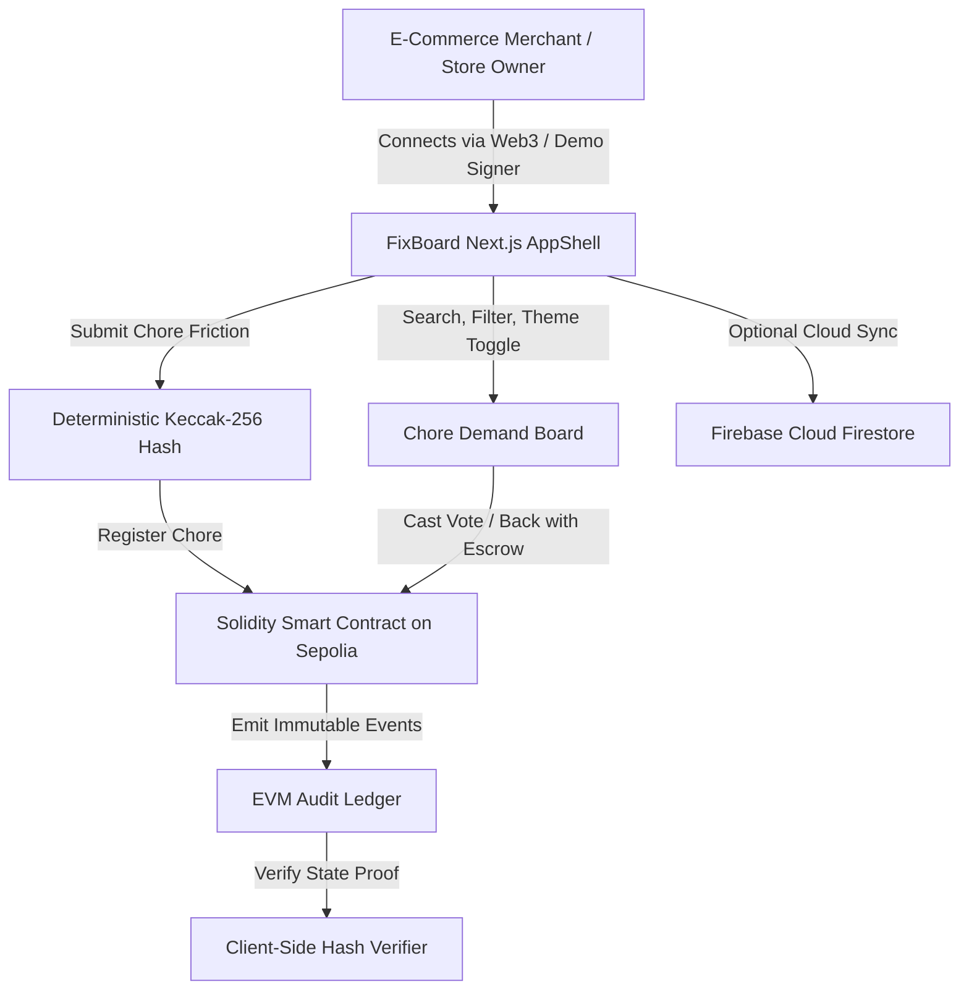

# FixBoard — Decentralized E-Commerce Demand & Bounty Board

> **Crowdsourced automation for Amazon, Shopify & multi-channel merchants, secured by Ethereum & Solidity smart contracts.**

<div align="center">

[](https://fixboard-iota.vercel.app/)
[](https://nextjs.org/)
[](https://sepolia.etherscan.io/)
[](https://soliditylang.org/)
[](LICENSE)

### 🔗 **[Explore Live Application &rarr;](https://fixboard-iota.vercel.app/)**

</div>

---

## 🌟 Overview

Online merchants on **Amazon**, **Shopify**, **Walmart**, and **eBay** lose hundreds of hours each quarter to repetitive operational chores — from fragmented multi-channel catalog reconciliations to carrier dim-weight disputes. 

**FixBoard** is a specialized B2B operations and demand board where e-commerce merchants post recurring operational friction, rally verified peer votes, and pool escrow bounties. Every chore registration, upvote, and funding pledge is backed by **Ethereum Solidity smart contracts** for tamper-proof mathematical consensus.

---

## ⚡ Core Features & Capabilities

### 🎨 Calm, Dense B2B Interface
- **Engineered for High-Frequency Use**: Restrained **Deep Indigo** palette (`#4F46E5` / `#6366F1`) with high-contrast cool neutrals meeting **WCAG 2.2 AA** standards.
- **3-State Theme Engine**: Seamless toggle between **System**, **Light**, and **Dark** modes with zero-flash pre-hydration initialization.
- **Responsive Layout Shell**: Collapsible operations sidebar, sticky topbar with instant search filters, and an adaptive bottom tab bar for mobile viewports (`<720px`).
- **Non-Blocking Feedback**: Accessible, polite toast notifications for transactions, upvotes, and clipboard actions.

### 🛡️ Ethereum & Solidity Consensus Layer
- **1-Wallet-1-Vote Rule**: Sybil-resistant demand validation. Votes are cryptographically bound to Ethereum signer addresses to eliminate bot astroturfing.
- **Deterministic Keccak-256 State Proofs**: Every registered chore's canonical state is hashed on-chain. Client-side verifiers allow any participant to independently detect unauthorized data tampering.
- **Escrow Bounty Pledging**: Merchants back chores in testnet Sepolia ETH or USD equivalents.
- **Dual-Mode Web3 Access**:
  - **EIP-1193 Compatible**: Seamless connection with MetaMask, Brave, Coinbase Wallet, or Rabby.
  - **Instant Sandbox Demo Relayer**: Visitors can immediately vote, pledge, and post without browser extensions or gas fees.

### 📊 Comprehensive Operations Tools
- **Chore Demand Feed**: Multi-category filtering (Catalog, Returns, Sync & API, Listings, Pricing, Shipping) with real-time pain severity scoring (1–5).
- **Seller Analytics Pulse**: Breakdown of operational bottlenecks, resolution status distribution, and multi-channel marketplace impact.
- **Cryptographic Hash Verifier**: In-browser client tool that computes real-time SHA-3 / Keccak-256 digests and cross-references the deployed Sepolia ledger.
- **Decentralized Audit Trail**: Standalone and modal-accessible audit ledger displaying all immutable state transitions with direct Etherscan transaction links.

---

## 🏛️ System Architecture



---

## 📂 Project Structure

```
fixboard-next/
├── contracts/
│   ├── FixBoard.sol           # Solidity contract (voting, escrow, audit log)
│   └── FixBoardABI.json       # Contract ABI for ethers.js
├── components/
│   ├── AppShell.js            # Unified B2B layout with sidebar, topbar & bottom nav
│   ├── Sidebar.js             # Collapsible operations nav with network health indicators
│   ├── TopBar.js              # Real-time search, breadcrumbs, audit badge & post trigger
│   ├── ThemeToggle.js         # 3-state segmented control (System / Light / Dark)
│   ├── ChoreCard.js           # Dense B2B chore card with voting, tags & escrow bar
│   ├── ChoreDetailModal.js    # Detail view with Keccak-256 state proof & discussion
│   ├── PledgeModal.js         # Escrow funding modal (Sepolia ETH & USD)
│   ├── NewChoreModal.js       # Chore registration with gas-free relayer
│   ├── WalletModal.js         # Web3 connection & Sepolia balance manager
│   └── AuditTrailModal.js     # Filterable EVM audit ledger & client verifier
├── lib/
│   ├── AppContext.js          # Unified application & Web3 state manager
│   ├── ThemeContext.js        # Light/Dark/System theme engine with localStorage sync
│   ├── ToastContext.js        # Accessible notification queue
│   ├── firebase.js            # Cloud Firestore client (with offline fallback)
│   └── web3.js                # Ethereum Sepolia provider & Keccak-256 hasher
├── pages/
│   ├── _app.js                # Next.js app wrapper with Theme & Toast providers
│   ├── _document.js           # Flash-free inline theme initialization & Inter font loader
│   ├── index.js               # Demand Board, Analytics Pulse & Hash Verifier
│   └── audit.js               # Standalone Ethereum Audit Ledger page
├── styles/
│   ├── globals.css            # Design tokens, typography, spacing & theme variables
│   └── components.css         # Component-specific token styles & responsive utilities
├── package.json
└── README.md
```

---

## 🚀 Quickstart & Local Development

### Prerequisites
- [Node.js](https://nodejs.org/) v18 or higher
- [npm](https://www.npmjs.com/)

### 1. Clone & Install
```bash
git clone https://github.com/bit-coder91/fixboard.git
cd fixboard
npm install
```

### 2. Run Locally
```bash
npm run dev
```

Visit [http://localhost:3001](http://localhost:3001) in your browser.

### 3. Production Build
```bash
npm run build
npm run start
```

---

## 🌐 Deploy to Vercel (100% Free)

FixBoard is fully optimized for zero-configuration deployment on **Vercel**:

1. Fork or push this repository to your GitHub account.
2. In Vercel, click **"Add New Project"** and select `fixboard`.
3. Keep default settings:
   - **Framework Preset**: `Next.js`
   - **Build Command**: `npm run build`
   - **Output Directory**: Default (`.next`)
4. Click **Deploy**.

> **Live Production URL**: [https://fixboard-iota.vercel.app/](https://fixboard-iota.vercel.app/)

---

## 📜 Smart Contract Reference

| Parameter | Value |
| :--- | :--- |
| **Network** | Ethereum Sepolia Testnet |
| **Chain ID** | `11155111` |
| **Contract Address** | [`0x83A41b2B54848039e246944B27CFe6cf1A4676cD`](https://sepolia.etherscan.io/address/0x83A41b2B54848039e246944B27CFe6cf1A4676cD) |
| **Compiler** | Solidity `^0.8.19` |
| **Gas Costs** | Free (Sepolia Testnet) |
| **Faucet** | [sepoliafaucet.com](https://sepoliafaucet.com) |

---

## 📄 License

This project is licensed under the **MIT License** — see the [LICENSE](LICENSE) file for details.
